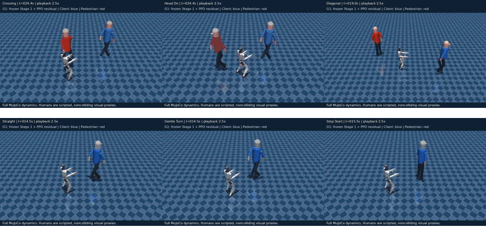

# How Stage 2 learned pedestrian avoidance

*A beginner-friendly explanation of the actual G1 escort experiments, including the failed approaches, the successful method, and the limits of the evidence.*

ECE 598JK Humanoid Escort Research · 9 November 2026

## 1. The task: keep following, but make room

Stage 1 taught the G1 to accompany one moving client: follow about 1.5 m behind, turn with the client, and stop in formation. Stage 2 adds one moving pedestrian. The G1 now needs to anticipate an encounter, slow down or yield, temporarily deviate from the ideal following position, and recover afterward. Avoiding the pedestrian while permanently abandoning the client does not count as success.

There are six scenario families. Three retain the Stage 1 skills; three introduce encounters. A family means a type of situation, not one fixed animation. Seeds randomize trajectories within its constraints.

| Family | Training probability | What it exercises |
|---|---:|---|
| Straight following | 15% | Ordinary formation maintenance |
| Gentle turns | 12.5% | Following a changing heading |
| Client stop/start | 12.5% | Braking, settling and restarting |
| Crossing pedestrian | 35% | Yielding before paths intersect |
| Head-on lane pass | 12.5% | Maintaining separation while passing |
| Diagonal pedestrian | 12.5% | Oblique approach, avoidance and recovery |

Clients retain the Stage 1 peak-speed settings of 0.15–0.25 m/s. Pedestrian peak speeds range from 0.25–0.45 m/s; their acceleration limit is 0.4 m/s². Diagonal angles range from 110–145 degrees in the generator's convention, and head-on lane offsets range from 0.6–0.8 m. These are configuration ranges, not guarantees of identical difficulty. The client and pedestrian follow scripted paths; neither learns to react to the robot.

## 2. What is actually simulated

The controller has two levels. The high-level neural policy decides how to move around people. The frozen NVIDIA AGILE gait decides how to walk and balance while following those commands. MuJoCo integrates the full G1's joints, forces and ground contacts.

**Escort decision at 5 Hz → frozen AGILE inference at 50 Hz → MuJoCo physics at 500 Hz.**

One high-level decision lasts 0.2 s and ordinarily executes 100 physics steps and ten gait calls. The action has three normalized numbers: forward velocity, lateral velocity and yaw rate. After mapping, commands remain capped at ±0.6 m/s, ±0.6 m/s and ±0.9 rad/s. Those software limits do not imply that the G1 achieves those speeds. Earlier isolated measurements found sustained forward motion around 0.407 m/s at the forward command cap.

The high-level learner never moves the robot's base directly or controls joint torque. During a rollout, translation comes from gait control and simulated dynamics. Reset may initialize its private robot state; a normal step may not teleport it. Nothing here launches ROS, publishes live commands, or controls a running Grove simulator.

An important distinction: the humans are noncolliding scripted proxies. A person drawn as a human in a clip is a visual representation, not a physically articulated person. Pedestrian safety is evaluated using a swept geometric footprint: a 0.30 m robot pelvis disc against a 0.25 m pedestrian disc. Negative surface clearance is an intrusion. It is not a physical MuJoCo robot–human contact. Robot–ground dynamics are still fully simulated.

## 3. What the neural controller can see

An observation is the numerical snapshot the policy receives before choosing an action. The external contract remains a 40-element float32 vector. It contains current causal information, not the future trajectory that the simulator used to generate the episode.

| Indices, zero-based | Contents | Intuitive meaning |
|---|---|---|
| 0–1 | Client-relative planar position | Where the client is relative to the G1 |
| 2–3 | Client-relative planar velocity | Whether the gap is opening or closing |
| 4–5 | Relative heading sine/cosine | Which way the client faces, without angle wrap jumps |
| 6–7 | Desired client-frame formation offset | The requested location, normally 1.5 m behind |
| 8–9 | Client validity/freshness | Whether the client state is usable |
| 10–12 | Pelvis-origin planar velocity and yaw rate | How the robot is moving |
| 13–15 | Torso projected gravity | Tilt information |
| 16–18 | Torso angular velocity | Rotation and balance motion |
| 19–21 | Previous applied action | The preceding command, not a hidden future plan |
| 22–39 | Three six-value pedestrian slots | Relative position/velocity, radius and validity |

Stage 2 uses only the first pedestrian slot, indices 22–27. The other two are empty and invalid. No-pedestrian replay has all slots invalid. Positions and relative velocities use robot heading axes; the robot velocity measurement is at the pelvis origin rather than the body's inertial center of mass. These physical points can have different translational velocities during a turn. The gait's own input processing is separate and unchanged.

The actor receives scaled, clipped observations. Position scale is 16 m, relative-velocity scale 2 m/s, formation-offset scale 3 m, robot velocity scales [2, 2, 4], and torso-angular scale 10 rad/s. No new running observation normalizer was added for residual PPO.

The scenario family, future waypoints, route completion fraction and evaluator geometry do not enter the actor or critic. Scenario metadata is available for logging, dataset balancing, rewards and evaluation. That separation matters: otherwise a policy might appear intelligent by reading the answer from the simulator.

## 4. Actor, critic, imitation and PPO: how the ideas fit together

An **actor** is a neural network that maps observations to actions. An **MLP** is a stack of fully connected layers. The successful Stage 1 actor uses two hidden layers of 128 units with tanh activations. The Stage 1 critic has a separate two-layer network. A **critic** predicts future discounted return; it does not issue motion commands.

**Behavior cloning**, or BC, fits the actor to a teacher's actions using supervised learning. Think of watching a skilled driver and learning which steering or braking command they select in each situation. The teacher supplies action labels; the reward does not directly train the actor during BC.

**PPO** improves a policy from executed trajectories and their rewards. It compares what happened with what the critic predicted. A better-than-expected action can be made more likely; a worse-than-expected action can be made less likely. Its clipped objective and approximate-KL stopping limit update size, but do not guarantee safety or improvement.

**DAgger**, dataset aggregation, addresses a weakness of ordinary imitation. A student makes small mistakes and visits states the teacher did not encounter on its own successful route. We run the student, query the teacher on those actual visited states, append the labels, and fit again. In the residual experiments, collection used student actions without teacher execution overrides. Teacher labels did not magically rescue the rollout that produced them.

**Residual learning** changes what the actor learns. Instead of relearning all of following and avoidance in one network, we keep the good follower frozen and learn a correction. Imitation and PPO are training methods; residual control is an architecture. They can be combined, as they were here.

## 5. Why the straightforward Stage 2 approaches failed

The first Stage 2 transition activated the previously unused pedestrian inputs while preserving the good Stage 1 policy. New input columns were zero-initialized, so the old behavior initially stayed intact. But an unchanged follower naturally walks into crossing traffic. The first 5k Stage 2 PPO pilot kept 60/60 Stage 1 successes yet achieved only 20/60 pedestrian successes: all head-on cases passed, all crossing and diagonal cases failed with 40 intrusions.

### A better critic was useful infrastructure, not the missing maneuver

We prepared the critic and ran another bounded PPO continuation. Explained variance in logged batches rose to roughly 0.93, but validation remained 20/60. Better prediction of failure did not cause the actor to discover a sustained early braking or sidestepping sequence. A critic is like an informed coach; it cannot guarantee that the player ever tries the right move. This is evidence that critic calibration alone was insufficient at that budget, not proof that PPO could never learn avoidance.

### The reward was audited rather than blamed immediately

A matched audit executed 240 full-G1 diagnostic rollouts on the same 60 encounters. The 23 successful yields and seven successful sidesteps all beat their matched collisions and permanent stops under both total and discounted reward. Avoidance was physically feasible and globally worthwhile in these examples.

The audit also found a difficulty: early avoidance incurred immediate formation/progress costs, while clearance shaping activated about 2.8 s later. Delayed credit can make a good maneuver hard to discover. The reward was not proven universally correct, but the evidence did not justify blindly replacing it. It remained the control for the subsequent comparisons.

### A successful teacher did not automatically produce a successful student

A stop-only teacher solved crossings but only 3/20 diagonals. A revised causal teacher considered current-observation velocity candidates, including lateral responses. That teacher passed all 60 fixed pedestrian validation cases. We had demonstrated a useful behavior to imitate.

Yet the first 3,000-update full-actor imitation fit still achieved 20/60. Most demonstrations were ordinary following; only 698/10,878 labels, about 6.4%, were substantial interventions under the chosen action-difference threshold. Average prediction error could fall while the student still missed the few seconds that decided clearance.

Intervention-balanced fitting improved imitation errors, but closed-loop success worsened to 14/60, and Stage 1 formation degraded. Adding student-state labels restored head-on success but left crossings/diagonals unsolved and reduced Stage 1 success to 47/60. Some old scenarios failed because the robot no longer stopped and held still, despite acceptable final position.

The lesson was not that a 128-unit MLP is inherently too small. The experiments exposed preservation, state-distribution and action-timing problems. A larger network alone would not directly protect stopping behavior or supply missing demonstrations.

## 6. The turning point: freeze following, learn only avoidance

The residual architecture uses the selected successful Stage 1 5k actor as an immutable base. Its pedestrian inputs are always zeroed. The residual branch receives the causal observation plus compact risk features and the base action.

**Final normalized action = clip(base action + pedestrian-valid mask × residual correction, −1, 1).**

The mask is a hard validity test, not a separately learned network in this implementation. When no pedestrian is valid, execution bypasses the residual completely and returns the Stage 1 action. This is stronger than hoping a replay loss will preserve the old task: the architecture makes exact preservation possible, and tests verify it. It also means Stage 1 replay cannot teach the residual new no-pedestrian behavior; that is intentional.

The residual has 51 internal features: the existing 40 values, eight causal risk features, and the base's three actions. Its architecture is **51 → 128 tanh → 128 tanh → 3 logits**. The correction is twice tanh of those logits. A normalized correction can span ±2 because changing a base action from +1 to −1 requires a difference of −2. The executed action is still clipped to ±1 and still obeys the original physical command limits.

A separate critic in the PPO adapter uses the same 51 causal features and two 128-unit tanh hidden layers. No privileged route state was added. Freezing Stage 1 does not mean freezing this new critic or the residual actor.

### Predicting risk without reading the future

The internal risk features summarize distance, closing speed, time to closest approach, predicted separation, a candidate-motion closest approach, its separation deficit, and client speed. There are eight numerical features in total. They are derived from the observation and a four-second constant-velocity horizon.

For relative position r and relative velocity v, closest-approach time is approximately:

**tCPA = clip(−(r · v) / max(v · v, epsilon), 0, 4 s)**

**predicted separation = length(r + tCPA × v)**

Imagine two people continuing at their current velocities. These formulas estimate when they would be closest. This is a causal prediction from the present, not access to the scripted pedestrian's future waypoints. The prediction can be wrong when someone accelerates or turns; it is a compact risk cue, not a guarantee.

### Teacher consistency had to be checked

The original teacher had an internal previous-command variable. Holding the observation fixed while changing that hidden variable changed its action by more than 0.05 normalized L2 in 59.58% of stress probes. That does not mean 59.58% of the actual dataset had contradictory labels; exact duplicate observations with conflicting labels were not found. It did show that a memoryless student could face an avoidable hidden-history dependency.

The revised supervision teacher reconstructs that preference from the previous applied action already present in the observation. Only one of 5,394 historical labels changed by more than the audit threshold under this reconstruction. The revised teacher was separately revalidated at 60/60 pedestrian success. We did not silently treat a different teacher as if it had already been tested.

## 7. How residual imitation became useful beyond two examples

We first overfit one crossing and one diagonal development scenario. An overfit test asks a narrow question: can the representation and training procedure learn these maneuvers at all? It does not establish generalization. BC solved both; two student-only DAgger rounds retained both. Three phases of 4,000 supervised updates gave 12,000 residual BC updates.

Fixed validation then reached 38/60: crossing 12/20, diagonal 17/20, head-on 9/20. Stage 1 remained 60/60, with 11,892 saved observation/action pairs exactly matching the base traces. The architecture preserved the old task, but two examples did not cover enough encounter geometry.

Coverage v2 retained those anchors and added six training-only examples across both sides of crossing, head-on and diagonal encounters. Family/side/case balancing prevented numerous examples from one family from overwhelming head-on replay. BC plus student-state aggregation added 8k updates, reaching 20k cumulative residual BC. All eight development cases passed; fixed validation reached 45/60. Head-on improved while diagonal regressed. More fitting was not uniformly better.

Variation v3 retained all eight examples and added four positive-side crossing speed/timing combinations plus four diagonal side/angle combinations. The same extra 8k phase budget brought the lineage to **28k residual BC updates**. Teacher readiness was 16/16; the student went from 12/16 to 14/16 and then 16/16 after student-only aggregation. Fixed validation reached **57/60**: crossings and head-on all passed, diagonals 17/20. Two client losses and one intrusion remained.

This sequence improved coverage rather than merely running the same two routes for longer. Still, new data and additional fitting changed together, so we cannot attribute all improvement to data alone. Cases were training-partition examples; fixed-validation trajectories were not copied into the training labels.

## 8. Clipping-aware supervision and important moments

The residual target is the teacher action minus the frozen base action. But the final action is clipped, so different raw corrections can produce the same executed command. The implementation fits executed actions and includes a residual-target term plus a penalty for excessive saturation. This respects the actual command that the gait will receive instead of treating every unconstrained correction as equally meaningful.

The residual BC configuration gives phase weights of 1 for ordinary following, 4 for anticipation, 8 for avoidance, 4 for recovery and 4 for stopping. The original residual-target coefficient is 0.25 and saturation-excess coefficient 0.01. Coverage fitting also balances families, sides and cases. These are recorded experimental choices, not universal optimal values.

Why emphasize these moments? A one-second late brake can decide the episode, even when the previous twenty seconds of following are accurate. Why keep stopping and recovery? A network that avoids a pedestrian but cannot return to formation or settle at the endpoint still fails the escort task.

## 9. The reward and success conditions used for the successful pilot

The successful PPO pilot kept **stage2_tracking_clearance_v1**. This adds geometric pedestrian clearance to Stage 1's **tracking_stop_v3** objective. No reward weights were retuned between the 57/60 BC source and the 60/60 PPO result.

Formation error is measured in the client's heading frame:

**e = R(client heading)ᵀ × (robot position − client position) − [−1.5 m, 0].**

The formation component is −dt × rho(length(e)/0.75, cap 10). Here rho(z) is z² up to z=1, then 2z−1, capped at the configured maximum. Small errors have a smooth quadratic cost; large errors grow less aggressively before the cap. Velocity tracking similarly penalizes the difference between robot displacement/0.2 s and desired formation-point displacement/0.2 s, scaled by 0.25 m/s and capped at 4.

Progress earns four reward units per newly credited metre, subject to accompaniment and behind-client checks. Its high-water ledgers require both actual robot route progress and bounded progress toward the desired formation point to advance. Moving the client while the G1 stands still does not earn new robot progress; returning repeatedly to an already credited location does not repeatedly pay.

The command-change component is −0.02 times squared normalized action change. Torso-stability shaping is also weighted 0.02. Pedestrian clearance contributes:

**rClearance = −2 × dt × min(1, max(0, (0.30 m − clearance)/0.30 m))².**

An intrusion terminates the episode and applies the configured failure outcome. Terminal success gives +20; failure gives −100. Full implementation details, including eligibility conditions, are in the source references rather than hidden in this description.

Success requires reaching the endpoint in formation with genuine accompanied robot progress, followed by a sampled one-second stop hold. The hold checks window drift speed ≤0.05 m/s, excursion ≤0.10 m, instantaneous planar speed ≤0.15 m/s and absolute yaw rate ≤0.1 rad/s. Final formation tolerance is 0.75 m, and recovery time after client arrival is five seconds. A client more than 3 m away continuously for three seconds produces client loss. Falls, supervisor failures, physics failures and bounds handling remain enforced. Time limits are truncations, not successful terminations.

These rules explain why “it reached the endpoint” or “the mean distance looks good” was insufficient in earlier failed fits. Correct stopping and avoidance are part of completion.

## 10. Why try PPO before imitation reached 100%?

There is no mathematical rule that imitation must reach 100% before reinforcement learning can help. We had a strong 95% residual with the old task protected structurally. A small, explicitly authorized PPO experiment could test whether reward-guided adjustments improve the remaining encounters. The decision did not waive the zero-intrusion promotion gate: running a research pilot and declaring a curriculum stage passed are different decisions.

The BC archive is not a PPO resume. The adapter imports the learned residual weights, creates a new critic, and starts a fresh PPO optimizer. BC Adam moments do not become PPO Adam moments. The original Stage 1 actor remains frozen. This transition is recorded in manifests rather than disguised as uninterrupted PPO training.

Before PPO, 24 stochastic training-partition episodes were collected, four per family. All succeeded. The critic was fitted for 6,000 supervised updates, holding out one complete episode per family. Whole-episode holdout avoids calling neighboring frames independent examples. Holdout MSE improved from 126.75 to 8.67, beating a constant-return comparator at 24.07. This measures return prediction, not policy success. Critic preparation does not update the actor, action variance or PPO optimizer.

## 11. The conservative residual PPO experiment

| Setting | Pilot value |
|---|---:|
| New residual PPO budget | 5,000 transitions |
| Worker/device | One independent environment, CPU |
| Learning rate | 0.000003 |
| Rollout / minibatch | 512 / 128 |
| Optimization epochs | 5 |
| Discount gamma / GAE lambda | 0.99 / 0.95 |
| PPO clip range / target approximate KL | 0.1 / 0.005 |
| Entropy coefficient / value coefficient | 0 / 0.5 |
| Maximum gradient norm | 0.25 |
| Fixed latent Gaussian sigma | 0.01 |
| Root seed | 923001 |

The stochastic action is sampled in **latent residual space**. If f(o) is the imported residual's three logits, then u is sampled from Normal(f(o), 0.01² I). Execution is clip(base + 2 tanh(clip(u,−20,20)),−1,1) for a valid pedestrian. The ±20 internal bound satisfies SB3's finite-action-space requirement; it is not a physical speed cap. A small latent sigma is not a fixed physical-velocity sigma because tanh and final clipping change sensitivity.

PPO stores and scores the raw Gaussian latent. It does not pretend that the final saturated motor-independent velocity command has an ordinary Gaussian density. This matters for correct likelihood ratios. With no pedestrian, the distribution's latent sample, entropy and log-probability contribution are zero, and execution returns the base action exactly.

The target-KL mechanism is approximate stopping of optimization on collected data, not a hard safety shield. Checkpoints, strict source/config/runtime hashes, scenario RNG states, fixed validation, and termination monitoring remain necessary.

### A software failure was repaired without discarding the experiment

The first prepared run crashed in its initial training-step logger because NumPy arrays are not directly JSON serializable. The prepared archive had zero PPO transitions and zero optimizer updates. The fix converts NumPy arrays/scalars, tests the actual production callback on full-G1 rollouts, and narrowly permits migration of the known pre-fix zero-update archive while retaining strict checks. Critic collection did not have to be repeated.

Resume restores policy, optimizer and saved worker/global RNG streams after model setup. Partial physical episodes and partial rollout buffers are not restored; new episodes begin. This avoids the earlier project's scenario-RNG replay failure, in which model loading reseeded restored streams. The successful pilot log has 24 unique scenario seeds across 24 starts, including one unfinished episode; 23 episodes completed.

## 12. What actually worked: measured results

| Fixed validation measure | Residual BC source | Residual PPO 5k |
|---|---:|---:|
| Crossing | 20/20 | 20/20 |
| Head-on | 20/20 | 20/20 |
| Diagonal | 17/20 | 20/20 |
| All pedestrian cases | 57/60 | 60/60 |
| Geometric intrusions | 1 | 0 |
| Minimum surface clearance | −0.03012 m | +0.05524 m |
| Pedestrian-suite mean formation error | 0.13531 m | 0.13269 m |
| Stage 1 | 60/60 | 60/60 |
| Stage 1 mean formation error | 0.0563095368 m | 0.0563095368 m |

The frozen base parameters are identical before and after PPO; residual parameters changed. Complete Stage 1 summary objects match exactly. All 23 completed training episodes succeeded. Training executed 500,000 physics steps and 50,000 gait calls, with 200 optimizer steps. Measured training wall time was 156.38 s, or 31.97 transitions/s, excluding critic preparation and validation. Optimizer time was about 0.354 s, so collection and associated overhead dominate this measurement. Physics, inference and logging were not individually profiled here.

A fresh-process second round reproduced both complete fixed-suite summaries exactly. The checkpoint satisfies the configured two-round repeatability criterion: at least 80% pedestrian success overall and in every encounter, at least 95% Stage 1 overall and 90% per original family, bounded mean formation regression, and zero intrusions or critical failures. The per-round utility still leaves automatic promotion false; it does not launch the next stage.

The correct conclusion is **a successful imitation-initialized residual PPO refinement for this selected model seed on the fixed suites**. It is not PPO learning avoidance from scratch. Two rounds are repeats of the same 120 cases, not 240 distinct scenarios. The study has not isolated each ingredient with equal-budget ablations, so it cannot prove that any one ingredient alone caused the improvement.

## 13. The complete progression, at a glance

| Attempt | Pedestrian validation | What it established |
|---|---:|---|
| Stage 1-derived Stage 2 PPO pilot | 20/60 | Following survived; crossing/diagonal avoidance not discovered |
| Critic preparation + bounded continuation | 20/60 | Better value diagnostics alone were insufficient |
| Successful causal teacher v2 | 60/60 | Demonstrated feasibility, not neural student success |
| Plain full-actor imitation | 20/60 | Low average action error did not ensure avoidance |
| Intervention-balanced full-actor fit | 14/60 | Rare-state fitting improved while closed-loop preservation degraded |
| Aggregated full-actor fit | 20/60; Stage 1 47/60 | Student-state labels alone did not protect the old controller |
| Frozen-base residual, two examples | 38/60 | Learned maneuvers and exactly retained Stage 1; coverage incomplete |
| Residual coverage v2, eight cases | 45/60 | Broader coverage helped unevenly |
| Residual variation v3, sixteen cases | 57/60 | Strong imitation initialization; one intrusion still blocked promotion |
| Calibrated, guarded residual PPO 5k | 60/60 | Reward-guided refinement passed both fixed suites |
| Fresh-process confirmation | 60/60 | Reproduced the fixed-suite result exactly |

These branches have different data, update counts and architectures; the table is development history, not an equal-budget algorithm benchmark. Old failed archives remain diagnostic evidence and are not forward-use controllers.

## 14. How to interpret the clips



The companion clips cover one representative episode from each of the six families. They use the selected 5k residual PPO checkpoint, with full G1 MuJoCo execution and a separate display model. Blue is the client; red is the pedestrian. Human-shaped render geometry changes appearance only. No robot trajectory is generated by a kinematic animation or base teleportation.

The diagonal clip uses validation seed 3000037, which previously produced an intrusion under the imitation source and succeeds under this checkpoint. It is deliberately useful for explanation, not a randomly selected independent test. Other clips are representative fixed-suite examples. [Open the six-video gallery](../media/stage2_selected_5k_20261109/index.html). Each entire episode is shown at approximately 2.5× speed, so braking latency and walking pace must be read from simulation timestamps, not screen playback duration. An individual good clip is not a replacement for the aggregate 60+60 results.

## 15. What remains uncertain

Minimum validation clearance is only about 5.5 cm under a pelvis-disc approximation. Full-body geometry, reactive people and perception uncertainty could change practical safety. Current client observations are simulator-pose proxies, not visual tracking. No physical-hardware or human-subject safety claim is warranted.

Fixed validation has repeatedly informed engineering decisions; untouched final-test cases remain needed for a later definitive evaluation. New development routes and additional training seeds would test robustness beyond deterministic repetition. Full numerical parity with asynchronous live Grove ROS/DDS execution is still unverified. The successful isolated scheduling is not evidence that live timing matches exactly.

The next milestone should preserve this checkpoint and its regression suites while explicitly scoping any additional people or constraints. More training is not automatically better: prior experiments showed competence can deteriorate. Neither 100k training nor Stage 3 implementation is launched by this document or the clip tool.

## 16. Reproduction and source map

The authoritative editable model registry is **docs/bodyguard/MODEL_WEIGHTS.md**. Preserve each selected ZIP with its manifest and RNG sidecar. The selected final archive is:

`research/escort_rl/runs/residual_ppo_recovered_9htyqV/pilot/final.zip`

SHA-256: `67692f7d7586093290a9ae49d952b2e2012e4135214db5079713f28c49f0695b`.

The saved residual PPO counter is 5,000. The residual lineage also has 28,000 supervised BC updates, and the frozen base retains its historical 5,000 Stage 1 PPO transitions. These are different kinds of counters; adding them and calling the result “38k PPO transitions” would be incorrect. Preparation rollouts, validation and failed branches add research compute without becoming this model's PPO counter.

| Repository source | What to inspect |
|---|---|
| `research/escort_rl/stage2_config/stage2.yaml` | Mixture, pedestrian geometry and promotion gates |
| `research/escort_rl/escort_rl/stage2/env.py` | Geometric clearance and Stage 2 outcomes |
| `research/escort_rl/escort_rl/tracking_objective.py` | Position/velocity reward and stop hold |
| `research/escort_rl/diagnostics/stage2_residual.py` | Frozen base, causal features, teacher audit, BC/DAgger |
| `research/escort_rl/diagnostics/stage2_residual_variation_v3.yaml` | Sixteen-case training coverage continuation |
| `research/escort_rl/diagnostics/residual_ppo_policy.py` | Masked latent action law and new critic |
| `research/escort_rl/diagnostics/residual_ppo_pilot_v1.yaml` | Exact successful pilot hyperparameters |
| `research/escort_rl/diagnostics/residual_ppo.py` | Checkpoint/RNG protocol, critic preparation, evaluation |
| `research/escort_rl/RESIDUAL_PPO_5K_RESULTS_2026-11-09.md` | Initial/final and second-round evidence |
| `research/escort_rl/RESIDUAL_PPO_PILOT_V1.md` | Operator run/evaluation commands and recovery details |
| `research/escort_rl/visualization/stage2_clips.py` | Isolated MP4/GIF rendering; no training |

Failed-experiment details are retained in STAGE2_PILOT_REVIEW, STAGE2_AFTER_CRITIC_REVIEW, STAGE2_TEACHER_FIT_REVIEW, STAGE2_DISTILLATION_V3_REVIEW, STAGE2_AGGREGATED_FIT_REVIEW and the three STAGE2_RESIDUAL_*RESULTS reports under research/escort_rl/. The concepts above explain these implemented methods; they are not claims of a systematic external literature review.

To regenerate all six clips into a new directory from the repository root:

```bash
export PYTHONPATH="$PWD/research/escort_rl:$PWD/research/escort_scenarios${PYTHONPATH:+:$PYTHONPATH}"
MUJOCO_GL=egl research/escort_rl/.venv/bin/python \
  research/escort_rl/visualization/stage2_clips.py \
  --output docs/media/stage2_selected_5k_NEW_RUN
```

Use a new output path each time. This runs visualization episodes, not optimization. Clips and per-episode trace/summary files are evaluator artifacts and never policy inputs.
